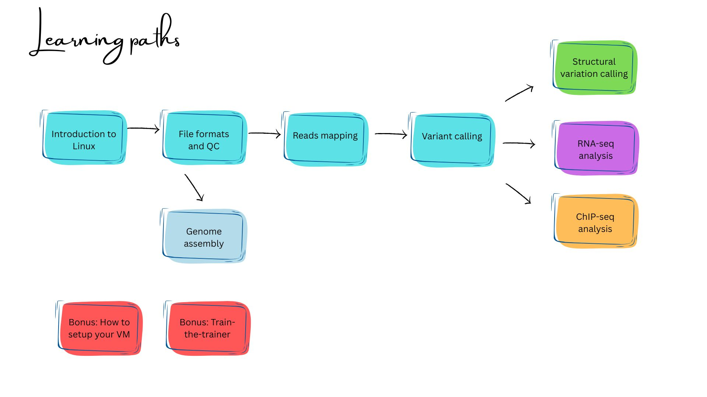

---
title: "Welcome"
sidebar: false
---

**Welcome to the course on Genome Sequence Analysis!**

This practical course will take you through the complete workflow of genome sequence data analysis. You'll learn key steps including quality assessment, read alignment, variant calling, annotation and genome assembly.

## Choose your path

::: {.grid}

::: {.g-col-12 .g-col-md-4}
### 👩‍🎓 Participants
Course material, exercises and datasets for each module.

[Start here →](participants.qmd){.btn .btn-primary}
:::

::: {.g-col-12 .g-col-md-4}
### 🧑‍🏫 Instructors
Instructor notes, solutions and train-the-trainer resources.

[Start here →](instructors.qmd){.btn .btn-primary}
:::

::: {.g-col-12 .g-col-md-4}
### 🏛️ Hosts
Computing setup, platform requirements and course logistics.

[Start here →](hosts.qmd){.btn .btn-primary}
:::

:::

